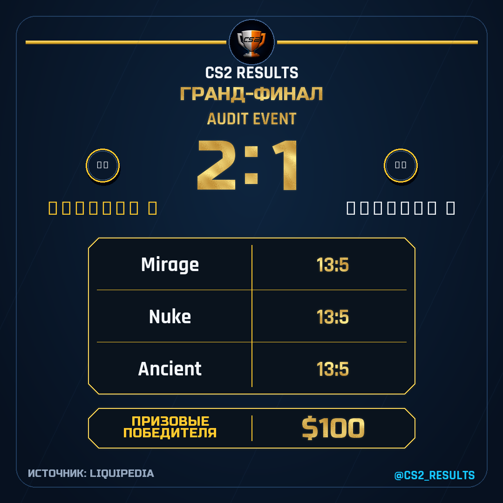

# Ревью CS2results — 28 октября 2026

Этот документ фиксирует аудит `b363ac0` до исправлений.
[Локальные исправления от 29 октября и их границы](review-fixes-2026-10-29.md).

Завершено 29 октября. Исходники, проверки и облачные сведения относятся
к зафиксированному 28 октября снимку; новое production-состояние 29 октября
в рамках завершения отчёта не запрашивалось.

Проект содержит подтверждённые ошибки. Найдены **12 дефектов: 2 P1, 9 P2 и 1 P3**,
а также рассинхронизация рабочей папки, противоречия документации и эксплуатационные
ограничения. Наиболее существенны возможность повторной отправки из-за гонки claims
и блокировка новых выпусков после повторного включения формата в админке.
Зелёные штатные тесты этих сценариев не исключают.

Это результат ревью, а не исправление реализации. Изменений production и публикаций
в рамках аудита не выполнялось. Доказательства используют синтетические данные
и подменённую сеть; они не доказывают, что каждый сценарий уже случился в каналах.

## Проверенная версия и фактическое состояние

- Основная проверенная версия — GitHub `main`
  [`b363ac00cb30bd242d1fa71f218c1b0d04b7eacc`](https://github.com/vovakorn/CS2Results/commit/b363ac00cb30bd242d1fa71f218c1b0d04b7eacc).
  SHA независимо подтверждён GitHub API. Для проверок создан отдельный локальный
  снимок исходников, чтобы не затрагивать незавершённую работу.
- Папка `/Users/user/Projects/CS2results` находится на `0cddf485961369195bd54ec6f866250798034e5c`
  и отстаёт от этого `main` на **165 коммитов**. До аудита в ней было 35 изменённых
  отслеживаемых файлов и 18 untracked-записей верхнего уровня `git status`, включая
  каталоги. Это отдельная старая рабочая копия, а не точное отражение production.
- Во время аудита внешний release-процесс сменил production с `d4e40kgvrkgv4s1p7rnj`
  (`54c912c`) на **`d4emhni9lbclf7ifgsb6` (`b363ac0`)**. Повторное read-only чтение
  Cloud API около 21:26 МСК подтвердило новый production и прежний `54c912c` как
  rollback. Аудит не выполнял переключение. Кодовые дефекты F01–F10 существуют
  и в `b363ac0`, и в предыдущем `54c912c`.
- Девять timer triggers ссылаются на `production`: восемь ACTIVE, старый радар
  PAUSED. Семь таймеров относятся к основной функции, остальные — к обновлению
  Threads OAuth и месячному VRS publisher. Утреннее расписание реально в 09:00 МСК,
  Reel в 09:15, digest в 23:00. Основной runtime — Python 3.12, 256 MiB, 120 секунд.
- В прямых access bindings основной функции нет публичных субъектов. Права,
  унаследованные от folder/cloud, и фактические права каждого сервисного аккаунта
  отдельно не анализировались.

Ссылки на код ниже закреплены за проверенным SHA: номера строк старой основной
папки могут отличаться.

## Подтверждённые дефекты

### F01 · P1 · Перехват claim после перехода другого invocation в attempting

**Место:** [storage.py:755](https://github.com/vovakorn/CS2Results/blob/b363ac00cb30bd242d1fa71f218c1b0d04b7eacc/cs2bot/match_sources/storage.py#L755),
повторное чтение на строках 808–814.

`_reclaim_expired_claim` после CAS-конфликта повторно проверяет только `expires-at`.
Состояние `delivery-state` внутри повторной итерации не проверяется. Другой invocation
может успеть забрать просроченный lease и перейти в `attempting` или `uncertain`;
у этих состояний expiry равен нулю. Проигравшая сторона читает новый ETag и перезаписывает такой
claim как `sending`, снова получая право отправки.

**Влияние:** нарушение защиты от дублей для content и channel claims при конкретной
гонке. Offline FakeS3 воспроизводит `other_attempting_claim_overwritten=true`,
конечное состояние `sending`. Обычный тест запрещённых состояний проверяет только
состояние до входа в reclaim и пропускает переход между CAS и refetch.

**Исправление:** на каждой итерации повторно отклонять все non-reclaimable states
до conditional PUT. Добавить гонки с переходом в attempting/uncertain/sent между
первым чтением, CAS-конфликтом и повторным чтением.

### F02 · P1 · Выключение и включение формата блокирует новые выпуски

**Место:** [main.py:321–330](https://github.com/vovakorn/CS2Results/blob/b363ac00cb30bd242d1fa71f218c1b0d04b7eacc/cs2bot/main.py#L321),
[publication_admin.py:112](https://github.com/vovakorn/CS2Results/blob/b363ac00cb30bd242d1fa71f218c1b0d04b7eacc/cs2bot/publication_admin.py#L112).

Выключение увеличивает generation, включение сохраняет увеличенное значение.
Свежие schedule, Telegram schedule_context и сохранённый radar-путь проверяются
как generation=0. После первого цикла выключить → включить policy может разрешать
публикацию с generation=1, но проверка возвращает false даже для нового дня.
Digest отдельно захватывает актуальное поколение и этого дефекта не имеет.

**Влияние:** расписание/контекст перестают автоматически публиковаться после
нормальной операции владельца. Радар сейчас PAUSED, поэтому его часть — скрытая.
Шесть proof-сочетаний соответствуют реальным маршрутам. Седьмое — Instagram radar —
проверяет только общий helper на синтетических параметрах: такого publisher
в radar job нет, и он не заявлен в публичном реестре админки.

**Исправление:** фиксировать текущее поколение для каждого нового выпуска;
сохранённую очередь продолжать проверять по её исходному поколению. Проверить
полный цикл переключения на уровне jobs, а не только `policy_status`.

### F03 · P2 · Удержанная очередь может перекрыть все безопасные повторы

**Место:** [storage.py:517–525](https://github.com/vovakorn/CS2Results/blob/b363ac00cb30bd242d1fa71f218c1b0d04b7eacc/cs2bot/match_sources/storage.py#L517),
[main.py:3992](https://github.com/vovakorn/CS2Results/blob/b363ac00cb30bd242d1fa71f218c1b0d04b7eacc/cs2bot/main.py#L3992).

Loader возвращает первые 200 элементов после сортировки. Handler пропускает
приостановленные/старые поколения, сохраняя их для ручной проверки. Эти элементы
могут занимать одни и те же первые места в каждом invocation. Proof: 200 старых
generation=0 и один свежий generation=1 → два чтения подряд дают те же 200 объектов,
доступных новых элементов ноль.
Это блокирует выборку сохранённых повторов; свежие `current_targets` обычного
results-запуска могут доставляться независимо от неё.

**Исправление:** применять лимит к доступной для обработки очереди либо отдельно
хранить/выбирать удержанные элементы. Не разрешать старые поколения ради разгрузки.

### F04 · P2 · Серия через полночь получает разные cross-provider UID

**Место:** [models.py:187–189](https://github.com/vovakorn/CS2Results/blob/b363ac00cb30bd242d1fa71f218c1b0d04b7eacc/cs2bot/match_sources/models.py#L187),
та же логика в `final_bridge_uid` на строках 224–225.

День берётся из `end_date or date or start_date`. PandaScore сообщает конец,
Liquipedia может сообщать только старт. Для одной серии 28 октября 23:30Z →
29 октября 01:30Z canonical UID и final bridge различаются. После записи processed
для LP-финала проверка позднего PandaScore возвращает false.

**Влияние:** возможен дубль, если LP-финал доставлен первым, а при позднем PS-ответе
повторное LP enrichment недоступно или финал уже вне полученной страницы. Успешное
enrichment может скрыть дефект; это не дубль на каждом переходе суток.

**Исправление:** единое правило identity времени и совместимые aliases для старых
маркеров; проверить границы UTC/Москвы и позднее появление основного источника.

### F05 · P2 · Сбой создания контейнера ошибочно блокирует публикацию как uncertain

**Место:** [threads_publish.py:132–153](https://github.com/vovakorn/CS2Results/blob/b363ac00cb30bd242d1fa71f218c1b0d04b7eacc/cs2bot/threads_publish.py#L132),
[instagram_publish.py:189–210](https://github.com/vovakorn/CS2Results/blob/b363ac00cb30bd242d1fa71f218c1b0d04b7eacc/cs2bot/instagram_publish.py#L189).

Один `_meta_post` одинаково трактует транспортные ошибки создания `/media` или
`/threads` и финального publish. При ConnectTimeout первого запроса соединение
не установлено, publish endpoint не вызывался, но caller получает DeliveryUncertain.
Main удаляет result outbox, сохраняет non-reclaimable claim и блокирует Threads chain.

**Влияние:** безопасно повторяемая подготовка переводится в ручную проверку;
автоматическая доставка материала останавливается, цепочка турнира удерживается.
Штатный тест Threads сейчас закрепляет эту ошибочную классификацию.

**Исправление:** различать стадии подготовки и фактической публикации.
Сохранять защиту uncertain для неоднозначного финального publish; сбои подготовки,
которые не могли опубликовать пост, оставлять повторяемыми.

### F06 · P2 · Финальная карточка допускает противоречие счёта серии и карт

**Место:** [media_cards.py:1534–1542](https://github.com/vovakorn/CS2Results/blob/b363ac00cb30bd242d1fa71f218c1b0d04b7eacc/cs2bot/media_cards.py#L1534),
[match_fetcher.py:67–75](https://github.com/vovakorn/CS2Results/blob/b363ac00cb30bd242d1fa71f218c1b0d04b7eacc/cs2bot/match_sources/match_fetcher.py#L67).

BO3 со счётом серии 2:1 и тремя картами 13:5 проходит upstream guard и рендер
гранд-финала. Проходит также карта 13:13. Обычный `_confirmed_result_maps` такие
данные отбрасывает; final-путь проверяет только присутствие числовых значений.

**Исправление:** общий валидатор законченных карт, числа побед, счёта серии и BO
с явной обработкой технических исходов и map advantage, если они поддерживаются.
Нельзя просто требовать обычные две/три победы для всех форматов турниров.

### F07 · P2 · Названия на кириллице становятся квадратами

**Место:** [media_cards.py:1623](https://github.com/vovakorn/CS2Results/blob/b363ac00cb30bd242d1fa71f218c1b0d04b7eacc/cs2bot/media_cards.py#L1623),
таблицы на строках 1940–1942 и 2100–2101, инициалы на 878–884.

Final, призовые, VRS и часть initials fallback выбирают Rajdhani без кириллицы.
Другие карточки уже используют `_uses_cyrillic`, но эти пути пропущены.
В proof glyph «А» побайтово равен отсутствующему glyph; рендер «Команда А»
содержит квадраты. Тест доступности кириллицы в display-font не проверяет выбор
этого шрифта конкретным шаблоном.

**Исправление:** единый выбор шрифта по тексту во всех шаблонах и проверка реальных
glyphs в финале, обеих таблицах и initials, включая смешанные латиницу/кириллицу.

### F08 · P2 · Обрыв тела логотипа обходит предусмотренный fallback

**Место:** [media_cards.py:712–723](https://github.com/vovakorn/CS2Results/blob/b363ac00cb30bd242d1fa71f218c1b0d04b7eacc/cs2bot/media_cards.py#L712).

Начальный `requests.get` ловит RequestException, а чтение `iter_content` ловит
только MediaCardError. Обрыв после HTTP 200 выбрасывает ConnectionError или
ChunkedEncodingError через `_draw_logo` вместо перехода к запасному изображению
или инициалам. Reel job также не обрабатывает этот сырой тип своим обычным catch.

**Влияние:** частичная недоступность необязательного логотипа способна прервать
рендер/выпуск. Proof подменяет успешные заголовки и ошибку streaming body.
**Исправление:** нормализовать streaming exceptions в MediaCardError в цикле
кандидатов, сохранив закрытие response и предусмотренный fallback.

### F09 · P2 · Telegram-итоги турнира и VRS не записываются в журнал

**Место:** [main.py:1203–1208](https://github.com/vovakorn/CS2Results/blob/b363ac00cb30bd242d1fa71f218c1b0d04b7eacc/cs2bot/main.py#L1203),
[main.py:1353–1359](https://github.com/vovakorn/CS2Results/blob/b363ac00cb30bd242d1fa71f218c1b0d04b7eacc/cs2bot/main.py#L1353).

Оба успешных пути фиксируют sent/processed и удаляют outbox, но не вызывают
`_record_post_analytics`/`record_publication`. Социальные аналоги вызывают.
Публикация доставлена, но новый подтверждённый факт отсутствует в обзоре/журнале.
Это не ограничение старой истории до подключения админки. Proof обоих путей:
одна отправка, одно удаление outbox, ноль записей в journal wrapper.

**Исправление:** best-effort запись подтверждённого факта для обоих Telegram-путей;
ошибка журнала не должна разрешать повтор внешней отправки.

### F10 · P2 · Лимит журнала выбирает самые старые 500 записей

**Место:** [publication_admin.py:185–206](https://github.com/vovakorn/CS2Results/blob/b363ac00cb30bd242d1fa71f218c1b0d04b7eacc/cs2bot/publication_admin.py#L185).

Ключи имеют дату в возрастающем формате. ListObjectsV2 читается до limit=500,
после чего сортируется только уже выбранный старый фрагмент. При 500 старых и
одной сегодняшней записи сегодняшняя публикация отсутствует, «Сегодня» показывает 0.
Лимит и отсутствие индекса уже признаны в `docs/telegram-admin.md`; конкретное
последствие для текущих счётчиков существеннее общей оговорки о неполной истории.

**Исправление:** ограничивать запрос периодом/префиксами дат либо читать нужный
диапазон до применения лимита; показывать неполноту, если охват ограничен.

### F11 · P2 · Архив social publishing не содержит зависимостей renderer

**Место:** [build_social_publish_zip.sh:15–22](https://github.com/vovakorn/CS2Results/blob/b363ac00cb30bd242d1fa71f218c1b0d04b7eacc/scripts/build_social_publish_zip.sh#L15),
[media_cards.py:1385](https://github.com/vovakorn/CS2Results/blob/b363ac00cb30bd242d1fa71f218c1b0d04b7eacc/cs2bot/media_cards.py#L1385).

Скрипт копирует `media_cards.py`, но не `tournament_visuals` и другие новые
зависимости брендирования/их данные. В изолированно распакованном архиве вызов
`_threads_visual_test_card()` падает с `ModuleNotFoundError: cs2bot.tournament_visuals`.
Импорт и тесты из полного checkout скрывают неполноту пакета.

**Влияние:** документированный отдельный visual test publisher не работает после
сборки текущим скриптом. Основной архив функции собирается другим скриптом;
этот finding не означает падения ежедневного production publisher.
**Исправление:** замкнуть зависимости пакета и добавить offline render smoke
именно распакованного ZIP с исключением исходного checkout из sys.path.

### F12 · P3 · Документированная команда сборки админки не исполняется

**Место:** [scripts/build_admin_function_zip.sh](https://github.com/vovakorn/CS2Results/blob/b363ac00cb30bd242d1fa71f218c1b0d04b7eacc/scripts/build_admin_function_zip.sh),
команда в `docs/telegram-admin.md:114` и `docs/yandex-cloud-deploy.md:59`.

Файл сохранён в Git с mode 100644. Прямой запуск `scripts/build_admin_function_zip.sh`
завершается Permission denied. Через `bash scripts/build_admin_function_zip.sh`
архив успешно собирается.
**Исправление:** executable bit либо явный `bash` во всех инструкциях; проверять
именно документированную команду в CI.

## Соответствие документации

| Источник | Несоответствие | Что считать фактом |
| --- | --- | --- |
| `docs/requirements.md:59` | Указано расписание 10:00 МСК | Timer в Cloud API, README и deploy docs задают 09:00; требуется согласовать одно время |
| `docs/architecture.md:187–188,200` | Tier результатов описан как диагностический, фильтр как строго LAN | Код `filters.py:138–148` и requirements допускают PandaScore S/A без сведений venue с сохранением жёстких исключений |
| `docs/requirements.md:97–104` | Любой LP replacement требует полных карт и целиком использует LP | После 20 минут разрешён table-only обычный result; UID/VRS/artwork PS могут сохраняться. `docs/data-contract.md:380–398` точнее отражает код |
| `docs/requirements.md:39–42` | Обещаны разрешённые online-стадии, но `is_lan=false` всегда запрещён | Код следует буквальному запрету. Одинаковая стадия может пройти с unknown venue и не пройти с explicit online. Это вопрос продуктового правила, а не отдельный доказанный code bug |
| Основная рабочая папка | Контекст/production snapshot в основном описывают 2 октября и версию сентября | Основной актуальный код и live production относятся к 28 октября; нельзя запускать релиз из старой папки без отдельного переноса и сверки изменений |

Не считались новыми дефектами: исторические записи о прежних версиях, если они
явно обозначены историей; старые ошибки VRS uncertain и потери `vrs_impacts`, уже
исправленные в актуальном main; неподтверждённые обещания роста охвата.
Проверка относительных файловых ссылок всех tracked Markdown актуального SHA
не нашла отсутствующих целей.

## Функциональность, тесты и эксплуатация

Проверены основные сценарии: results/retry, schedule/context, digest и его
подготовительные повторы, LP final admission/replacement, турнирные таблицы и VRS,
preview/calendar, Telegram/Instagram/Threads delivery, owner policy/journal,
OAuth renewal, Reels и отдельный Node/monthly VRS pipeline, сборки и release gates.
Ревью охватывает ключевые контуры проекта; оно не является доказательством
отсутствия иных ошибок или полной проверкой всех исторических артефактов.

| Проверка | Результат |
| --- | --- |
| Штатные Python-тесты `b363ac0` | Все 1 421 уникальных теста подтверждены после целевых повторов ниже |
| Первичный полный pytest | 1 394 passed, 27 failed: 26 deploy-тестов из-за отсутствующей Git metadata в архивном снимке; 1 из-за запрета loopback bind в sandbox |
| Повтор deploy-файла после восстановления metadata снимка | 38 passed; все 26 первоначальных отказов устранены без изменения кода |
| Повтор единственного loopback-теста вне sandbox | 1 passed |
| Node source/timeline/monthly/handler/safe-zone | 27 passed; использован локальный комплект node_modules с идентичным pnpm lockfile |
| Дополнительные offline proof-тесты ревью | 20 passed; подтверждают существование дефектов, а не правильность поведения |
| Business proof | Три дефекта воспроизведены; четвёртая проверка — неоднозначность online-требования |
| `pip check` установленного venv | Успешно; это не утверждение равенства всех установленных версий pinned requirements |
| `pip-audit -r requirements.txt --no-deps --disable-pip` | Известных уязвимостей pinned runtime-списка не найдено на дату проверки |
| Compileall / `git diff --check` актуального снимка | Успешно |
| Основной, monthly, OAuth и social publish ZIP | Собраны; admin ZIP собран через bash, прямой запуск выявил F12 |
| Изолированный renderer из social ZIP | Воспроизведён F11 |
| CI PR #171 | Python 3.11/3.12 и Node jobs — success; CI также содержит packaged Linux render/decode |

CI подтверждён через GitHub для head `51c814d`, слитого в `b363ac0`.
[Проверки PR #171](https://github.com/vovakorn/CS2Results/pull/171/checks).
Новый полный Linux video render в рамках этого аудита не выполнялся; проверены
существующий CI и Node-тесты, сохранённые synthetic PNG просмотрены вручную.

Сильные стороны реализации: durable outbox, conditional PUT/CAS, отдельные
предохранители неопределённой доставки, изолированные publisher/renderer,
проверка source provenance, сохранение generation и широкие регрессии рендера.
Основные пропуски тестов — пересечения состояний между модулями: гонка после CAS,
реальный job после повторного включения, большая удержанная очередь, переход суток,
streaming body, замкнутость ZIP и полнота журнала после успешной доставки.

Оставшиеся эксплуатационные ограничения:

- Чтение startup-логов текущего candidate во время аудита завершилось ошибкой.
  Новое состояние тегов само по себе не подтверждает проверку журналов; аудитор
  не устанавливал причину сбоя лог-сервиса и не разрешал исключений release gate.
- GitHub API показал `main.protected=false`, список repository rulesets пуст.
  CI существует, но обязательность его прохождения не обеспечена этими branch
  правилами. Это наблюдение о настройке репозитория, не доказательство обхода
  проверок при каком-либо конкретном релизе.
- Не проверялись реальные экраны Telegram на телефоне/desktop, текущее истечение
  Meta-токенов, полная история публикаций и delivery claims, биллинг, реальные
  показатели подписчиков/охвата, лицензионная экспертиза медиа. Секреты не извлекались.
- Первая плановая месячная VRS-публикация на дату ревью ещё в будущем: 1 ноября
  за октябрь. Нельзя считать её фактически успешной по dry-run и тестам.

## Порядок устранения

1. F01 и F02: восстановить инварианты однократной доставки и повторного включения.
2. F03–F05: доступность очереди и корректная идентичность/классификация попыток.
3. F06–F08: смысловая корректность и устойчивость контента.
4. F09–F12 и документы: достоверность наблюдения, воспроизводимость сборки и
   единый действующий контракт. Изменения переносить в актуальный изолированный
   checkout; старую рабочую папку не сбрасывать и не подтягивать поверх чужих правок.

## Воспроизводимые материалы

В [пакете доказательств](reviews/2026-10-28/README.md) находятся 20 proof-тестов,
business probe с captured JSON и два синтетических PNG. Эти проверки намеренно
assert существующие дефекты. После исправлений их следует преобразовать в
регрессии ожидаемого поведения.

Пример финала с противоречивыми картами и отсутствующими glyphs:

